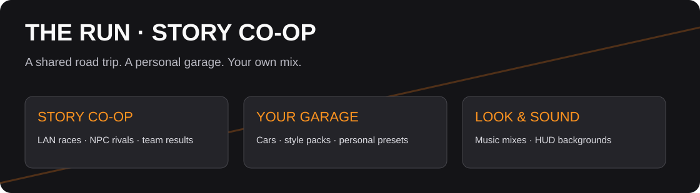
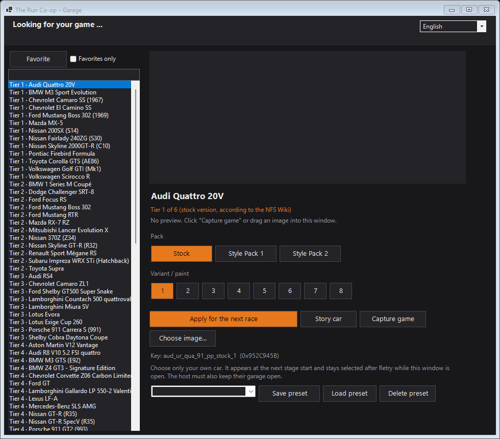
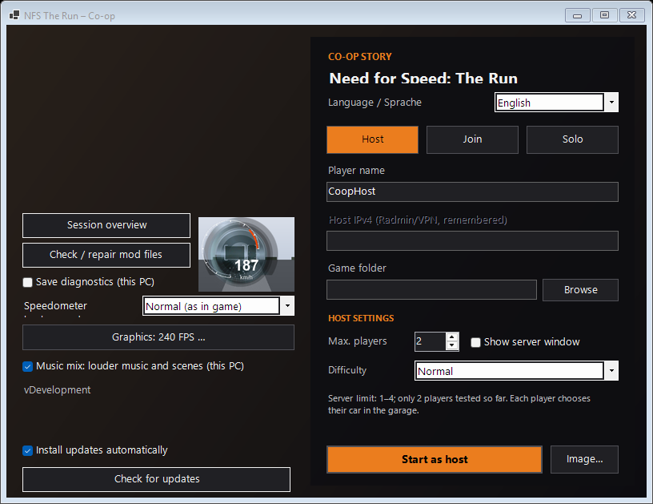
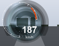
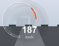
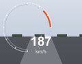
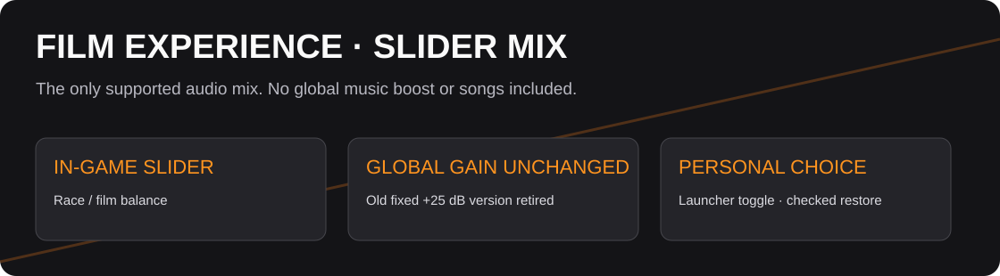

# The Run Story Co-op

**Turn the road trip into a shared run.** An experimental LAN co-op project for
Need for Speed: The Run, with a bilingual launcher, a personal garage, music mods
and a cleaner HUD.

[Download v0.7.8-TEST](https://github.com/DogeDuck/NFS-The-Run-LAN-Coop-Mode/releases/tag/v0.7.8-TEST)
· [English setup](README-EN.md) · [Deutsche Anleitung](README-DE.md)
· [All mods / Alle Mods](MODS.md)

> **v0.7.8-TEST.** Includes the new host QTE mirror, cutscene AI/collision protection,
> player lights/names and launcher improvements. The combined build and remote QTE
> transport still need gameplay testing. Full campaign/four-player compatibility is unverified.

## Our mods and tools

| Project | What it adds | Status |
|---|---|---|
| **Story Co-op** | LAN story races, restored NPC competition, team results, Battle/Eliminator fixes and improved human starting positions | Included in test builds; individual story scenes still have known issues |
| **Launcher + Solo with mods** | Host / Join / Solo, saved host IP, host difficulty, personal graphics and music settings, GitHub updates, German / English | Included in v0.7.8-TEST; newest combination requires gameplay testing |
| **Garage car changer** | Choose your own car, style pack and paint; host relays guest choices; keep the selected car for later events | Included; avoid the native gas-station car selector |
| **Film Experience slider mix** | Adjust the race music/car balance with the game's slider; checked reversible patching | Only slider mix included; no global +25 dB boost |
| **Speedometer background mod** | Original, 15% opacity or removed backgrounds; preview in the launcher | Included in v0.7.8-TEST; asset patch locally applied |
| **QTE / cutscene work** | Local actor selection and host-owned story milestones; work on scene control and shared QTEs | Host QTE input passed local10.4; new remote transport and cutscene protection are experimental |

### Garage and launcher

*Preview before a game is connected. Favorites and named presets are included;
the newest garage/launcher combination has been tested offline.*

*German and English interfaces. Opt-in diagnostics, session overview and repair
are included in v0.7.8-TEST. These controls do not imply that every native gameplay fix is complete.*

### HUD background choices

| Original | Dim / 15% | Clear |
|---|---|---|
|  |  |  |

The HUD mod changes the speedometer backgrounds. QTE button prompts remain visible.
It is a visual preference, not a guarantee against OLED image retention.

### Music

Only the **Film Experience slider mix** is included. Global
music gain stays unchanged. The slider changes the race music/car balance; the
film side uses race music +6 dB and cars −4 dB. Premixed scenes use +8 dB and also
contain dialogue/effects. The old fixed +25 dB version has been retired.
No commercial music or game audio is redistributed here.

## Start playing

1. Own and install the supported PC game and the required LAN base mod.
2. Download and extract the complete published test package, then run `Install.cmd`.
3. Open `Launch-Coop.cmd` or `Launch-Coop.vbs`; choose Host, Join or Solo.
4. For remote LAN play, follow [Radmin English](RADMIN-EN.md) / [Radmin Deutsch](RADMIN-DE.md).
5. Keep the garage open to retain your car choice. Back up your save before testing.

## Aktueller Stand auf Deutsch

Unser Projekt verbindet Koop-Rennfixes mit Launcher, Garage, Musik-Mix und optional
reduziertem Tacho-Hintergrund. Die veröffentlichten Downloads sind Testversionen.
v0.7.8-TEST enthält Favoriten/Sets, Sitzungsübersicht, Reparatur und die HUD-Auswahl.
QTEs/Cutscenes sind weiter in Arbeit; ein lokaler Test mit nur einer Person kann
den unbedienten zweiten Client durch fehlende Eingaben scheitern lassen.

Autosound-Fixes stammen aus der Definitive Edition. Der aktuelle Zusammenstartpatch
hat Highway20 laut Nutzertest behoben. Die Brücke in1.51 und einzelne gescriptete
Übergänge bleiben gesonderte Baustellen.

## Credits

- Project and testing: DogeDuck, with development assistance from Codex/ChatGPT and Claude.
- **Definitive Edition** is by [BadassBaboon](https://github.com/BadassBaboon/NFS-TheRun-DE), not our original mod. Its license/source and pinned build are included with the package.
- Research: [mRally2's The Run Tools & Research](https://github.com/mRally2/The-Run-Tools-Research) and the original LAN mod authors credited in the package.
- Game, names and original artwork belong to their respective owners. No game executable, complete game archive, save or crash dump is supplied by this showcase.

[Changes / Änderungen](CHANGELOG.md) · [Updates and difficulty](UPDATES-DIFFICULTY.md)
